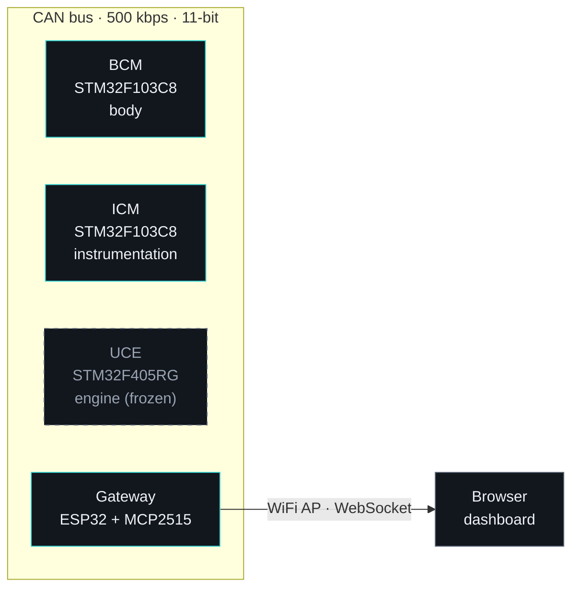

# Distributed Electronics for a Renault 5 GTL

<p>
  
  
  
  
  
  
</p>

🇪🇸 [Leer en español](README.md)

A distributed electronic system for a **1989 Renault 5 GTL** (G-C1J): several **FreeRTOS** nodes talking over a **500 kbps CAN bus**, with PlatformIO firmware and a combined BCM + Gateway PCB designed in KiCad. The goal: modernize the car in a **reversible** way, without modifying the original wiring harness.

> 🔴 **Development halted by an incident.** The car caught fire during normal driving, before the BCM could be installed, and development stopped there. The compiled firmware, the CAN protocol, the documentation and the PCB design (Gerbers included) are published as they were left, as a reference and as a reusable base for another vehicle.

> 🌐 The technical documentation in `docs/` is written in Spanish.

---

## Architecture



Each node is an independent board with its own firmware and FreeRTOS tasks; they only share the protocol and structs in `shared/`.

| Node | MCU | What it does |
|------|-----|--------------|
| **BCM** (Body Control Module) | STM32F103C8 (Blue Pill) | Drives lights (position, low beam, fog), horn and a flame effect through relays/MOSFETs; reads the driver controls through optocouplers. Fail-safe mode and watchdog. |
| **ICM** (Instrumentation Control Module) | STM32F103C8 (Blue Pill) | Reads RPM (optocoupler + interrupt), manifold pressure (MPX4250AP), coolant and intake air temperature (NTC) and battery voltage (INA219); publishes `ENGINE_DATA` every 50 ms. |
| **UCE** (Engine Control Unit) | STM32F405RG | Engine management (table-based ignition and injection, TunerStudio calibration). It never got to compile: frozen. |
| **Gateway** | ESP32 + MCP2515 | CAN ↔ WiFi bridge: forwards all bus traffic over WebSocket to a web dashboard served from its own flash (SPIFFS). |

## Highlights

- **Reversible install ("transparent mode").** The PCB intercepts the car's original relays without touching the harness: unplugging it leaves the car stock. Only the rear fog light (and, depending on the trim, the position lights) have a factory relay; the remaining channels are on the board but get connected later.
- **CAN fail-safe.** If the bus is silent for more than 5 s, the BCM turns on the position lights, blinks the alarm LED at 5 Hz, locks the effects and, after 5 min, turns the lights off to protect the battery. It returns to normal on its own as soon as bus activity is detected.
- **Watchdog.** The IWDG (1 s) is only kicked while the critical tasks (`CAN_RX`, `ALARM`) are alive; if one hangs, the node resets.
- **Exhaust flame effect.** Patterns are defined as frame tables (intensity + duration) at 30 fps, with automatic triggering on throttle lift-off (the ICM detects high RPM with low MAP and commands the BCM). Detachable external module.
- **WiFi dashboard.** The Gateway creates its own access point and serves a web page with live bus data.
- **Shared, tested protocol.** IDs and structures live in `shared/`, covered by native unit tests (Unity) that need no hardware.

## CAN protocol

Standard 11-bit frames at 500 kbps. Each node owns an ID range:

| Node | ID range |
|------|----------|
| BCM | `0x100`–`0x1FF` |
| ICM | `0x310`–`0x31F` |
| UCE | `0x400`–`0x41F` |
| Gateway | `0x700` |
| Broadcast (reset) | `0x7FF` |

Every node sends a one-second *heartbeat* with status flags and uptime. Frames, periods and commands are described in [`docs/CAN.md`](docs/CAN.md) and [`shared/Protocol.h`](shared/Protocol.h).

## Hardware and PCB

A single **BCM + Gateway** board, designed in KiCad:

- 2 layers, **159.5 × 142.5 mm**, 79 through-hole components plus pluggable modules (Blue Pill, ESP32 DevKit and MCP2515 on sockets, easy to replace).
- 100 % autorouted with Freerouting, ground plane on both layers, **DRC clean**. Gerbers for all 7 layers plus drill files in `Archivos Placa/gerbers/`.
- One shared 5 V rail (LM2596) for both nodes and the relay coils; a single CANH/CANL pair with a jumper-selectable 120 Ω termination.
- 12 V input protection: 3 A fuse, reverse-polarity P-channel MOSFET (IRF9540N) and TVS diode (P6KE18A).
- Each relay takes its +12 V from the intercepted original socket, so the car's per-circuit fusing is preserved.

The board **was never manufactured**. The design and its rationale are in [`docs/PCB_BCM_GATEWAY.md`](docs/PCB_BCM_GATEWAY.md) (Spanish).

## Project status

| Phase | Description | Status |
|-------|-------------|--------|
| Phase 1 | CAN bus bench validation (BCM + ICM + Gateway) | ✅ Done |
| Phase 2 | BCM + Gateway PCB (KiCad) | ✅ Design finished, Gerbers ready — never manufactured |
| Phase 3 | Physical installation in the car | 🔴 Not started — development halted by the fire |
| Phase 4 | Full Gateway + UCE (engine) | 🔴 Not started |

| Node | Firmware | Status |
|------|----------|--------|
| BCM | v3.2.0 | ✅ Built and bench-tested — never installed in the car |
| ICM | v3.1.0 | ✅ Built and bench-tested — never installed in the car |
| Gateway | v3.2.0 | ✅ Built and bench-tested — never installed in the car |
| UCE | v3.0.0 | ❌ Does not compile (pending errors) — frozen |

## Build and test

You need [PlatformIO](https://platformio.org/) (VS Code extension, or `pip install platformio`). Libraries download automatically. Each node is a standalone project:

```bash
cd BCM     && pio run                 # STM32F103 (flash with an ST-Link: pio run -t upload)
cd ../ICM  && pio run
cd ../Gateway && pio run && pio run -t upload && pio run -t uploadfs   # firmware + dashboard (SPIFFS)
```

The `platformio.ini` files contain serial ports from my machine (`monitor_port`, `upload_port`): change them to yours. Before flashing the Gateway, set your own WiFi password in `Gateway/src/Config.h` (the default value is a placeholder).

Protocol unit tests, no hardware needed:

```bash
pio test -e test_native --project-dir test/
```

## Repository layout

```
BCM/  ICM/  UCE/  Gateway/   per-node firmware (PlatformIO)
shared/                      common CAN protocol and structs
Archivos Placa/              KiCad project and PCB Gerbers
Super5.pretty/               custom footprint library
test/                        native unit tests
docs/                        technical documentation (Spanish)
```

## Documentation

All documents are in Spanish.

| Document | Contents |
|----------|----------|
| [`docs/CAN.md`](docs/CAN.md) | CAN protocol: IDs, frames, periods and special modes |
| [`docs/PINOUT.md`](docs/PINOUT.md) | Consolidated pinout for every node |
| [`docs/BCM_HARDWARE.md`](docs/BCM_HARDWARE.md) | BCM power supply, CAN transceiver, relays and optocouplers |
| [`docs/PCB_BCM_GATEWAY.md`](docs/PCB_BCM_GATEWAY.md) | Combined board design and manufacturing notes |
| [`docs/BOM.md`](docs/BOM.md) | Bill of materials |
| [`docs/INSTALL.md`](docs/INSTALL.md) | Build, deployment phases, per-node installation and troubleshooting |
| [`docs/CHANGELOG.md`](docs/CHANGELOG.md) · [`docs/PROPOSALS.md`](docs/PROPOSALS.md) | Change and decision history |

## Lessons learned

- The **TJA1050 needs 5 V** on VCC (never 3.3 V): at 3.3 V the transceiver transmits nothing and shows no visible error.
- On an ST-Link, **SWCLK and SWDIO are not interchangeable**: if it fails with `init mode failed`, check that the wires are not swapped before trying anything else.

More details in [`docs/INSTALL.md`](docs/INSTALL.md).

## Reusing this work

The CAN protocol, the node structure and the board can be adapted to another vehicle. If you do, keep in mind that the relay and connector maps in `docs/` belong to a 1989 Renault 5 GTL.

## License

MIT — see [`LICENSE`](LICENSE).
