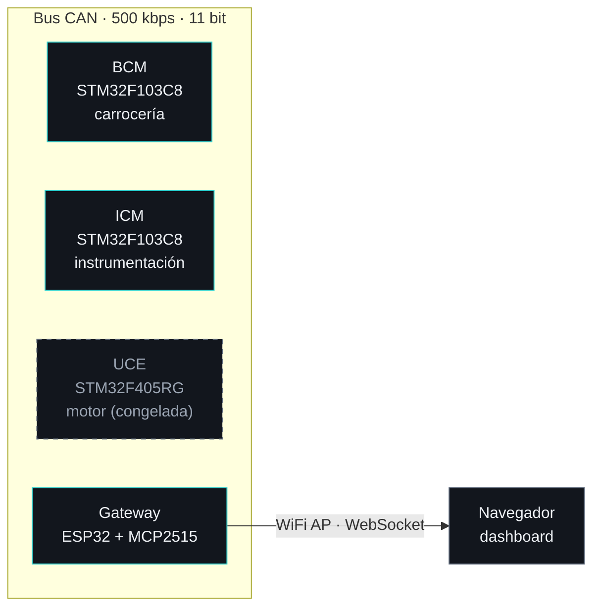

# Gestión electrónica distribuida para un Renault 5 GTL

<p>
  
  
  
  
  
  
</p>

🇬🇧 [Read this in English](README.en.md)

Sistema electrónico distribuido para un **Renault 5 GTL de 1989** (G-C1J): varios nodos con **FreeRTOS** que se comunican por **bus CAN a 500 kbps**, con firmware en PlatformIO y una PCB combinada (BCM + Gateway) diseñada en KiCad. La idea: modernizar el coche de forma **reversible**, sin modificar el arnés original.

> 🔴 **Desarrollo detenido por una incidencia.** El vehículo sufrió un incendio durante una marcha normal, antes de llegar a instalar el BCM, y el desarrollo se paró ahí. El firmware compilado, el protocolo CAN, la documentación y el diseño de la PCB (Gerbers incluidos) se publican tal cual quedaron, como referencia y como base reutilizable para otro vehículo.

---

## Arquitectura



Cada nodo es una placa independiente con su propio firmware y sus tareas FreeRTOS; todos comparten únicamente el protocolo y los structs de `shared/`.

| Nodo | MCU | Qué hace |
|------|-----|----------|
| **BCM** (Body Control Module) | STM32F103C8 (Blue Pill) | Luces (posición, cruce, antiniebla), bocina y efecto de llamas por relés/MOSFET; lee los mandos por optoacopladores. Modo fail-safe y watchdog. |
| **ICM** (Instrumentation Control Module) | STM32F103C8 (Blue Pill) | Lee RPM (optoacoplador + interrupción), presión de admisión (MPX4250AP), temperatura de refrigerante y de aire (NTC) y tensión de batería (INA219); publica `ENGINE_DATA` cada 50 ms. |
| **UCE** (Engine Control Unit) | STM32F405RG | Gestión de motor (encendido e inyección con tablas, calibración por TunerStudio). Nunca llegó a compilar: congelada. |
| **Gateway** | ESP32 + MCP2515 | Puente CAN ↔ WiFi: reenvía todo el tráfico del bus por WebSocket a un dashboard web servido desde la propia flash (SPIFFS). |

## Funciones destacadas

- **Instalación reversible ("modo transparente").** La PCB intercepta los relés originales del coche, sin tocar el arnés: desconectarla deja el coche de serie. Solo la antiniebla trasera (y, según versión, las luces de posición) tienen relé de fábrica; el resto de canales van en la placa pero se conectan más adelante.
- **Fail-safe CAN.** Si el bus calla más de 5 s, el BCM enciende las luces de posición, hace parpadear el LED de alarma a 5 Hz, bloquea los efectos y, pasados 5 min, apaga las luces para proteger la batería. Vuelve a la normalidad solo cuando detecta actividad.
- **Watchdog.** El IWDG (1 s) solo se alimenta si las tareas críticas (`CAN_RX`, `ALARM`) siguen vivas; si una se bloquea, el nodo se reinicia.
- **Efecto de llamas en el escape.** Patrones definidos como tablas de frames (intensidad + duración) a 30 fps, con activación automática en corte de gas (el ICM detecta RPM altas con MAP bajo y se lo ordena al BCM). Módulo externo desmontable.
- **Dashboard WiFi.** El Gateway crea su propio punto de acceso y sirve una web con los datos del bus en tiempo real.
- **Protocolo compartido y probado.** IDs y estructuras en `shared/`, con tests unitarios nativos (Unity) que no necesitan hardware.

## Protocolo CAN

Tramas estándar de 11 bits a 500 kbps. Cada nodo tiene su rango de IDs:

| Nodo | Rango de IDs |
|------|--------------|
| BCM | `0x100`–`0x1FF` |
| ICM | `0x310`–`0x31F` |
| UCE | `0x400`–`0x41F` |
| Gateway | `0x700` |
| Broadcast (reset) | `0x7FF` |

Todos emiten un *heartbeat* cada segundo con flags de estado y tiempo en marcha. Las tramas, periodos y comandos están en [`docs/CAN.md`](docs/CAN.md) y en [`shared/Protocol.h`](shared/Protocol.h).

## Hardware y PCB

Placa única **BCM + Gateway**, diseñada en KiCad:

- 2 capas, **159,5 × 142,5 mm**, 79 componentes THT más módulos enchufables (Blue Pill, ESP32 DevKit y MCP2515 sobre zócalos, para sustituirlos fácilmente).
- Ruteo automático con Freerouting al 100 %, plano de masa en ambas capas, **DRC sin errores**. Gerbers de las 7 capas y taladros en `Archivos Placa/gerbers/`.
- Un único riel de 5 V (LM2596) para ambos nodos y las bobinas de los relés; un solo par CANH/CANL con terminación de 120 Ω por jumper.
- Protección de entrada de 12 V: fusible de 3 A, MOSFET de protección contra polaridad inversa (IRF9540N) y TVS (P6KE18A).
- Cada relé toma su +12 V del zócalo original interceptado, por lo que se conserva la protección por circuito del propio coche.

La placa **nunca llegó a fabricarse**. El diseño y su justificación están en [`docs/PCB_BCM_GATEWAY.md`](docs/PCB_BCM_GATEWAY.md).

## Estado del proyecto

| Fase | Descripción | Estado |
|------|-------------|--------|
| Fase 1 | Validación del bus CAN en banco (BCM + ICM + Gateway) | ✅ Completada |
| Fase 2 | PCB del BCM + Gateway (KiCad) | ✅ Diseño terminado, Gerbers listos — nunca fabricada |
| Fase 3 | Instalación física en el vehículo | 🔴 No iniciada — desarrollo detenido por el incendio |
| Fase 4 | Gateway completo + UCE (motor) | 🔴 No iniciada |

| Nodo | Firmware | Estado |
|------|----------|--------|
| BCM | v3.2.0 | ✅ Compilado y validado en banco — nunca instalado en el vehículo |
| ICM | v3.1.0 | ✅ Compilado y validado en banco — nunca instalado en el vehículo |
| Gateway | v3.2.0 | ✅ Compilado y validado en banco — nunca instalado en el vehículo |
| UCE | v3.0.0 | ❌ No compila (errores pendientes) — congelada |

## Compilar y probar

Necesitas [PlatformIO](https://platformio.org/) (extensión de VS Code, o `pip install platformio`). Las librerías se descargan solas. Cada nodo es un proyecto independiente:

```bash
cd BCM     && pio run                 # STM32F103 (flasheo con ST-Link: pio run -t upload)
cd ../ICM  && pio run
cd ../Gateway && pio run && pio run -t upload && pio run -t uploadfs   # firmware + dashboard (SPIFFS)
```

Los `platformio.ini` traen puertos serie de mi equipo (`monitor_port`, `upload_port`): ajústalos a los tuyos. Antes de flashear el Gateway, define tu propia contraseña WiFi en `Gateway/src/Config.h` (el valor por defecto es un marcador).

Tests unitarios del protocolo, sin hardware:

```bash
pio test -e test_native --project-dir test/
```

## Estructura del repositorio

```
BCM/  ICM/  UCE/  Gateway/   firmware por nodo (PlatformIO)
shared/                      protocolo y structs CAN comunes
Archivos Placa/              proyecto KiCad y Gerbers de la PCB
Super5.pretty/               librería de footprints propia
test/                        tests unitarios nativos
docs/                        documentación técnica
```

## Documentación

| Documento | Contenido |
|-----------|-----------|
| [`docs/CAN.md`](docs/CAN.md) | Protocolo CAN: IDs, tramas, periodos y modos especiales |
| [`docs/PINOUT.md`](docs/PINOUT.md) | Pinout consolidado de todos los nodos |
| [`docs/BCM_HARDWARE.md`](docs/BCM_HARDWARE.md) | Alimentación, transceptor CAN, relés y optoacopladores del BCM |
| [`docs/PCB_BCM_GATEWAY.md`](docs/PCB_BCM_GATEWAY.md) | Diseño de la placa combinada y notas de fabricación |
| [`docs/BOM.md`](docs/BOM.md) | Lista de materiales |
| [`docs/INSTALL.md`](docs/INSTALL.md) | Compilación, fases de despliegue, instalación por nodo y resolución de problemas |
| [`docs/CHANGELOG.md`](docs/CHANGELOG.md) · [`docs/PROPOSALS.md`](docs/PROPOSALS.md) | Historial de cambios y de decisiones |

## Lecciones aprendidas

- El **TJA1050 necesita 5 V** en VCC (nunca 3,3 V): con 3,3 V el transceptor no transmite y no da ningún error visible.
- En un ST-Link, **SWCLK y SWDIO no son intercambiables**: si falla con `init mode failed`, revisa que no estén cruzados antes de probar otros trucos.

Más detalles en [`docs/INSTALL.md`](docs/INSTALL.md).

## Reutilizar este trabajo

El protocolo CAN, la estructura de nodos y la placa se pueden adaptar a otro vehículo. Si lo haces, ten en cuenta que los mapas de relés y conectores de `docs/` corresponden a un Renault 5 GTL de 1989.

## Licencia

MIT — ver [`LICENSE`](LICENSE).
